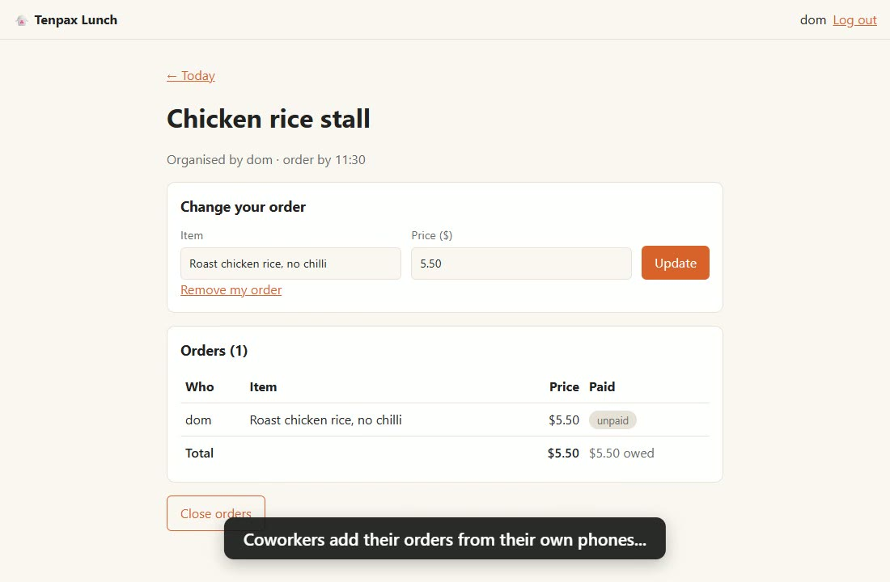

# Tenpax Lunch

A lunch-ordering app for 10 coworkers: start a lunch run, everyone adds their order, and the organizer sees the total and who has paid. No more scrolling the group chat.

**Live app:** https://jonyeecoder.pythonanywhere.com (joining needs the team code)

**Demo video (48 s):** https://jonyeecoder.github.io/tenpax-lunch/

[](https://jonyeecoder.github.io/tenpax-lunch/)

Built with Flask + SQLite.

The 4Cs problem statement, success metric and v1 scope are in [PLAN.md](PLAN.md).

## How it works
1. Coworkers join with a shared team code. The team is capped at 10 accounts.
2. Anyone can start a **lunch run** for today: the place and an optional order cutoff time.
3. Everyone adds or edits their order: the item and its price. Orders lock at the cutoff, when the organizer closes the run, or at the end of the day.
4. The organizer sees the full list and total, ticks off who has paid, and closes orders. If someone changes the price of a paid order, it goes back to unpaid.

## Run it locally
```bash
python -m venv .venv
.venv\Scripts\activate        # macOS/Linux: source .venv/bin/activate
pip install -r requirements.txt
copy .env.example .env        # macOS/Linux: cp .env.example .env
flask run
```
Edit `.env` first: the app refuses to start until `SECRET_KEY` is a real random value. Then open http://localhost:5000 and join using the `TEAM_CODE` from your `.env`.

| Setting in `.env` | What it does |
|---|---|
| `SECRET_KEY` | **Required.** Signs login cookies. |
| `TEAM_CODE` | What coworkers type to sign up. Empty closes sign-up. Use a random value and change it if it leaks; anyone with it can take one of the 10 seats. |
| `TIMEZONE` | Your team's timezone (default `Asia/Singapore`). Decides "today" and the cutoff. |
| `TRUST_PROXY` | `1` on PythonAnywhere, so login rate limits see each visitor's real IP. |
| `COOKIE_SECURE` | Cookies are HTTPS-only by default. Set `0` only to test over plain HTTP from another device. |

The database is a single file, `lunch.db`. It's created on first run and isn't committed.

## Develop
```bash
pip install -r requirements-dev.txt
pre-commit install          # lint and format with ruff on every commit
pytest --cov                # tests, with coverage
ruff check . && ruff format --check .
pip-audit -r requirements.txt
```
GitHub Actions runs the same checks on every push ([`.github/workflows/ci.yml`](.github/workflows/ci.yml)).

## Put it online (PythonAnywhere, free)
1. Sign up for a free **Beginner** account at [pythonanywhere.com](https://www.pythonanywhere.com/). Your app will be at `YOUR_USERNAME.pythonanywhere.com`.
2. Open **Consoles → Bash** and run:
   ```bash
   git clone https://github.com/jonyeecoder/tenpax-lunch.git
   cd tenpax-lunch
   bash deploy/setup_pythonanywhere.sh
   ```
   It writes `.env` with a random secret key and a random team code, and prints the team code for you to share.
3. Go to **Web → Add a new web app → Manual configuration → Python 3.12**.
4. On the Web tab, set **Source code** and **Virtualenv** to the paths the script printed.
5. Click the **WSGI configuration file** link and replace its contents with [`deploy/pythonanywhere_wsgi.py`](deploy/pythonanywhere_wsgi.py), using your username.
6. Turn on **Force HTTPS**, click **Reload**, and open your site.

**Updating later:** push from your computer, then in the PythonAnywhere Bash console run:
```bash
cd ~/tenpax-lunch && git pull && .venv/bin/pip install -q -r requirements.txt
```
Then click **Reload** on the Web tab.

Free apps are paused after 3 months unless you log in and click "Run until 3 months from today" on the Web tab.
